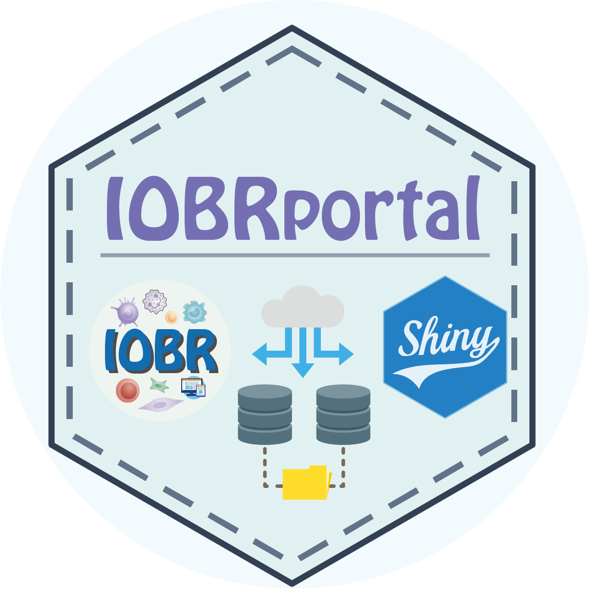
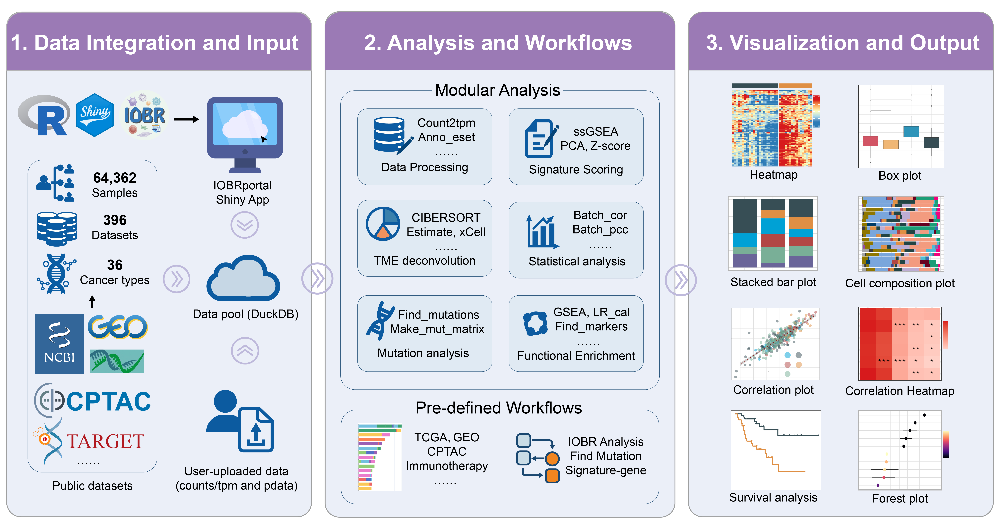
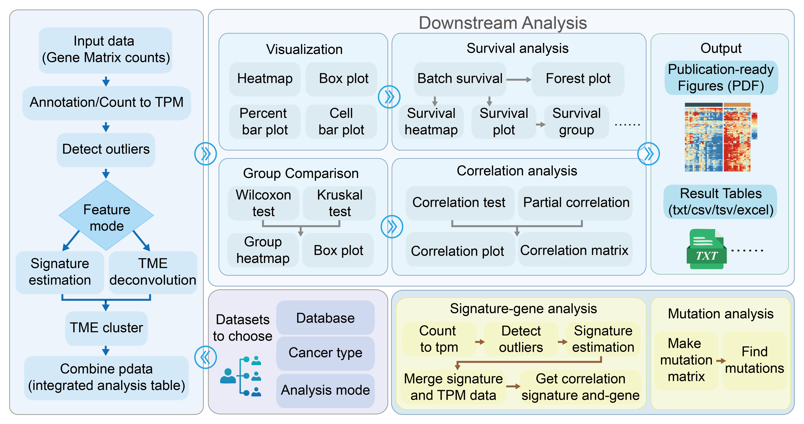

<table>
  <tr>
    <td width="190" align="center" valign="middle">
      
    </td>
    <td valign="middle">
      <h1>IOBRportal</h1>
      <p><strong>An interactive platform for bulk transcriptome and immuno-oncology research</strong></p>
      <p>From expression matrices and mutation data to tumor microenvironment profiling, statistical analysis, and publication-ready results.</p>
    </td>
  </tr>
</table>

<p align="center">
  <a href="https://iobr.github.io/IOBRportal/"></a>
  <a href="https://qingcongl.github.io/IOBRportal_book/"></a>
  <a href="https://github.com/IOBR/IOBRportal"></a>
  <a href="https://github.com/IOBR/IOBRportal/issues"></a>
  <a href="https://github.com/IOBR/IOBRportal/blob/main/LICENSE"></a>
</p>

<p align="center">
  <a href="https://iobr.github.io/IOBRportal/"><strong>Launch IOBRportal</strong></a>
  ·
  <a href="https://qingcongl.github.io/IOBRportal_book/">Read the documentation</a>
  ·
  <a href="#-installation">Install the R package</a>
</p>

## 🧭 Overview

IOBRportal is an R package and Shiny-based web platform for bulk transcriptome and immuno-oncology studies. Built on the IOBR analytical framework, it connects data preparation, signature scoring, tumor microenvironment (TME) deconvolution, clustering, mutation analysis, statistical testing, interactive visualization, and result export in a unified environment.

Users can either run analyses in the online application or install the R package for local, upload-based workflows.

<p align="center">
  
</p>

## 🔄 Analysis workflow

IOBRportal supports continuous analysis from expression or mutation data to interpretable tables and publication-ready figures.

<p align="center">
  
</p>

## 🚀 Choose how to use IOBRportal

| Mode | Best for | Access |
|:--|:--|:--|
| 🌐 **Web application** | Interactive analysis without writing R code; includes the full set of configured cohort resources | [Primary server](https://iobr.github.io/IOBRportal/) · [Backup server](https://lisom.work/shinyapps/IOBRportal/) |
| 📦 **R package** | Local deployment and analysis of user-uploaded expression, phenotype, survival, and mutation data | [Install from GitHub](#-installation) |

## 🧩 Workflows

| Workflow | Input or resource | Main capabilities |
|:--|:--|:--|
| 🧬 **Integrated Workflow** | User-uploaded expression and phenotype data | Annotation, counts-to-TPM conversion, outlier detection, signature scoring or TME deconvolution, clustering, phenotype integration, visualization, and statistical analysis |
| 🧫 **Mutation Workflow** | User-uploaded MAF data | Mutation-matrix construction, phenotype- or signature-associated mutation analysis, oncoprints, box plots, and survival analysis |
| 🔗 **Signature-Gene Workflow** | Expression matrices | TPM preprocessing, outlier removal, signature scoring, signature-gene correlation, and correlation-matrix construction |

## 🗂️ Cohort resources

IOBRportal currently incorporates **64,362 samples**, **396 datasets**, and **36 cancer types**. Public resources are organized into four entry categories:

- 🧬 **TCGA** — TCGA transcriptomic, clinical, TME, signature, and mutation resources
- 💉 **IMMC** — curated immunotherapy cohorts
- 🎗️ **MOLC** — curated cancer cohorts, primarily derived from GEO
- 🧫 **CLIC** — CPTAC and TARGET cohorts

In addition to these curated resources, IOBRportal supports user-uploaded expression, phenotype, survival, and mutation data.

## ✨ Key features

### 🧮 Signature scoring

- PCA-, ssGSEA-, and Z-score-based scoring
- multiple built-in signature collections
- batch calculation and integration with phenotype data

### 🔬 Tumor microenvironment deconvolution

- CIBERSORT
- EPIC
- quanTIseq
- xCell
- ESTIMATE
- TIMER
- MCPcounter
- IPS
- integration mode for combined TME estimation

### 📈 Statistical analysis

- batch correlation
- partial correlation
- batch survival screening
- Wilcoxon test
- Kruskal-Wallis test

### 🎨 Visualization

- heatmap
- box plot
- percent bar plot
- cell bar plot
- forest plot
- correlation plot
- correlation matrix plot
- survival plot
- survival group plot
- time-dependent ROC plot
- signature ROC plot
- GSEA plot
- oncoprints

## 📦 Installation

Install the development version from GitHub:

```r
if (!requireNamespace("remotes", quietly = TRUE)) {
  install.packages("remotes")
}

remotes::install_github("IOBR/IOBRportal", dependencies = TRUE)
```

Load the package and launch the local Shiny application:

```r
library(IOBRportal)
run_iobrportal()
```

> [!IMPORTANT]
> The local package supports upload-based workflows. Database-backed cohort resources are provided in the fully configured online deployment and may require separate data configuration in a local deployment.

## 📊 Outputs

IOBRportal generates downloadable analysis objects and publication-ready visualizations, including:

- processed expression and mutation matrices
- signature-score and TME-deconvolution tables
- cluster assignments and integrated phenotype-feature tables
- survival, correlation, and group-comparison statistics
- mutation-association result tables
- figures in publication-ready formats

## 📚 Documentation

Detailed tutorials, example datasets, parameter descriptions, and workflow demonstrations are available in the [IOBRportal Book](https://qingcongl.github.io/IOBRportal_book/).

## 📝 Citation

If you use IOBRportal in your research, please cite the IOBRportal paper or preprint when available, the original methods used in your analysis, and the following IOBR ecosystem papers:

1. Zeng D, Fang Y, et al. **Enhancing immuno-oncology investigations through multidimensional decoding of tumor microenvironment with IOBR 2.0.** *Cell Reports Methods*. 2024;4:100910. [doi:10.1016/j.crmeth.2024.100910](https://doi.org/10.1016/j.crmeth.2024.100910)

2. Fang Y, Kong Y, Rong G, Luo Q, Liao W, Zeng D. **Systematic investigation of tumor microenvironment and antitumor immunity with IOBR.** *Med Research*. 2025;1(1):136-140. [doi:10.1002/mdr2.70001](https://doi.org/10.1002/mdr2.70001)

## 💬 Support

- Report bugs or request features through [GitHub Issues](https://github.com/IOBR/IOBRportal/issues).
- E-mail **Qingcong Luo** at [qingcongl@163.com](mailto:qingcongl@163.com).
- E-mail **Dr. Dongqiang Zeng** at [interlaken@smu.edu.cn](mailto:interlaken@smu.edu.cn).

## 📄 License

IOBRportal is released under the [GNU General Public License v3.0](https://www.gnu.org/licenses/gpl-3.0.en.html).
